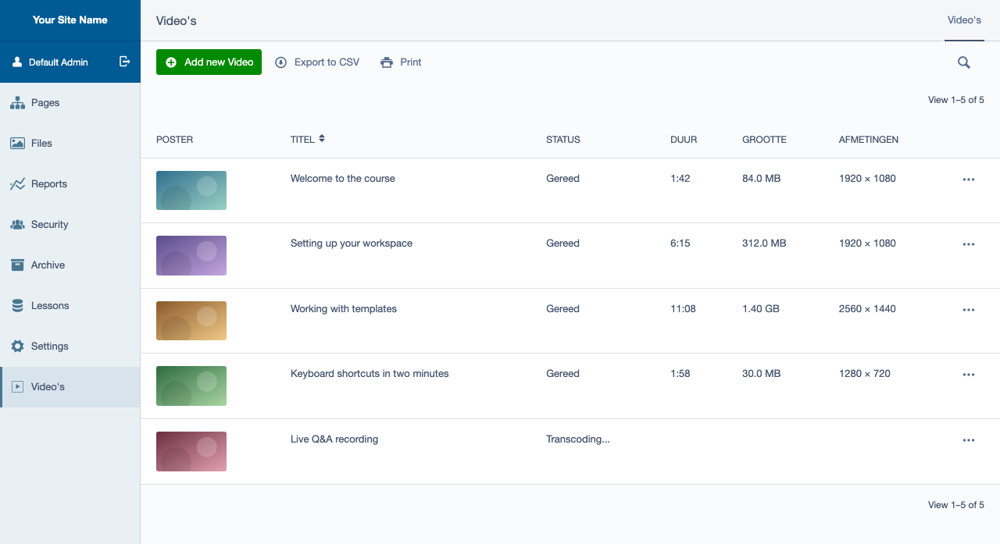
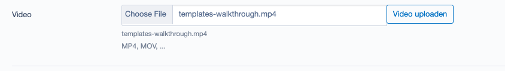
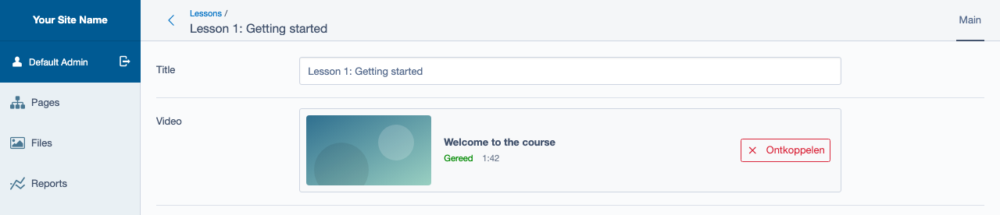

# Bunny Stream for Silverstripe

Upload videos from the Silverstripe CMS straight to [Bunny Stream](https://bunny.net/stream/),
manage them in a section of their own, and embed them with Bunny's player. The video file never
passes through your server: the editor's browser uploads it to Bunny, and Silverstripe keeps a
record of each video with the metadata Bunny reports back. For Silverstripe 5 and 6.



*Maintained by [Restruct](https://github.com/restruct). If this module saves you time, you can
[support ongoing maintenance](https://github.com/sponsors/restruct).*

*The screenshots come from a test site without Bunny credentials: the poster thumbnails and the
player are local stand-ins for what Bunny would serve. Everything else is the module's own UI.*

## Out of the box, a video is just a large file on your server

Silverstripe has no video hosting of its own. A video uploaded through Files goes through PHP (and
its upload size limits), is stored on your server and is served as a plain file download: no
transcoding to smaller renditions, no adaptive streaming, no player. Bunny Stream does all of that;
what is missing is the link between the CMS and Bunny's API.

This module adds that link:

* **`BunnyUploadField`**, a form field for a `has_one` to `BunnyVideo`: pick a file, it uploads to
  Bunny with a progress bar, and the relation is set when it finishes.
* **`BunnyVideo`**, a DataObject per video: title, description, status, duration, dimensions,
  storage size, an optional poster image, and per-video player options.
* **`VideoAdmin`**, a "Video's" section in the CMS listing every video with its thumbnail, status,
  duration, size and dimensions (above).
* **`BunnyStreamClient`**, a small client for the Bunny Stream API (create, get, list, delete),
  TUS upload signing, thumbnail URLs and (signed) embed URLs.

The CMS labels are Dutch and not translatable yet
([#3](https://github.com/restruct/silverstripe-bunnystream/issues/3)).

## Upload in the CMS, play from Bunny

### Attach a video to a record

Add a `has_one` to `BunnyVideo` and use `BunnyUploadField` for it:

```php
use Restruct\BunnyStream\Forms\BunnyUploadField;
use Restruct\BunnyStream\Model\BunnyVideo;

class Lesson extends DataObject
{
    private static $has_one = [
        'BunnyVideo' => BunnyVideo::class,
    ];

    public function getCMSFields()
    {
        $fields = parent::getCMSFields();
        $fields->replaceField(
            'BunnyVideoID',
            BunnyUploadField::create('BunnyVideoID', 'Video')
                ->setDescription('MP4, MOV, ...')
        );
        return $fields;
    }
}
```

Without a video, the field offers a file input and a "Video uploaden" button:



What happens on upload:

1. The field calls its `createUpload` action, which creates the video on Bunny, writes a
   `BunnyVideo` record (status "created") and returns short-lived TUS credentials.
2. The browser uploads the file directly to Bunny with [tus-js-client](https://github.com/tus/tus-js-client)
   (a pinned copy shipped in the module's `client/dist`, no CDN), showing progress.
3. When it finishes, the new record's ID is put in the field, so saving the form sets the relation.

With a video attached the field shows its thumbnail, title, status and duration, and an
"Ontkoppelen" button that clears the relation (the video itself is kept):



`createUpload` refuses anyone `BunnyVideo::canCreate()` refuses (403; by default anyone without
access to the "Video's" section, see [Who may manage videos](#who-may-manage-videos)), any request
without the form's security token (400), and a malformed title (400); the field's JavaScript sends
the token as `SecurityID`. Do not put the field on a public front-end form: visitors and members
without access to the "Video's" section are refused, so it cannot work there.

### Embed a video

```php
$video->getPlayerIframeHTML();                     // 16:9 <iframe> in a .ratio wrapper
$video->getPlayerIframeHTML(['autoplay' => true, 'muted' => true, 'loop' => true, 'controls' => false]);
$video->getPlayerURL();                            // the embed URL alone, signed when configured
$video->getThumbnailUrl();
```

`getPlayerIframeHTML()` returns `''` when the record has no video. The iframe is wrapped in
`<div class="ratio ratio-16x9">`, Bootstrap 5's aspect-ratio helper: without Bootstrap 5's CSS on
the page, give that wrapper a 16:9 ratio yourself. `autoplay` is always sent (default `false`) so a
library-level autoplay setting does not apply unless you ask for it. In a template,
`$BunnyVideo.PlayerIframeHTML` outputs the markup (it is cast as HTML).

### Per-video player options

Each video carries a small JSON store of player options, editable in the CMS under "Afspeelopties"
on the video's edit form:


| Option | CMS field | Default | Effect |
|--------|-----------|---------|--------|
| `rememberPosition` | Positie onthouden | on | Bunny embed parameter: resume where the viewer stopped. Always sent, so a per-video "off" overrides the library setting. |
| `t` | Starttijd | none | Bunny embed parameter: start offset, eg `90s`, `1m30s`, `hh:mm:ss`. |
| `enforceFullWatch` | Volledig bekijken afdwingen | off | Emitted as a `data-enforce-full-watch="1"` attribute on the iframe. **The module does not enforce it**: Bunny has no "disable seeking" parameter, so your front-end JavaScript has to read the attribute and act on it (eg through Bunny's player.js API). |

From PHP: `getPlayerOption($key, $default)`, `setPlayerOption($key, $value)` (`null` removes the
key), `getPlayerQueryParams()` and `getPlayerDataAttributes()`. Other keys can be stored too; only
the three above are acted on.

### Status and metadata

Bunny processes a video asynchronously (created, uploaded, processing, transcoding, finished, or
error / upload failed). While a video is neither finished nor failed, opening it in the CMS
refreshes its metadata from the API; an unreachable API leaves the stored values in place rather
than breaking the form. Call `refreshFromApi()` yourself to sync outside the CMS (it writes the
record). `isReady()` is true once Bunny reports the video finished; only then does the edit form
show the player.

### Where a video is used

When records point at a video through a `has_one`, its edit form has a "Gebruikt door (n)" tab
listing them, found by scanning the data model, so the module needs no configuration for your
classes. The same list is available as `getUsages()`.

### Who may manage videos

`BunnyVideo::canView()`, `canEdit()`, `canCreate()` and `canDelete()` all require what opening the
"Video's" section (`VideoAdmin`) requires: ADMIN or `CMS_ACCESS_LeftAndMain` (access to all CMS
sections), or else every code in `VideoAdmin`'s `required_permission_codes`. Out of the box that
is `CMS_ACCESS_LeftAndMain`, so an editor with access to only some sections (Pages, say) can
neither manage videos nor upload one: deleting a video also deletes it on Bunny (below).

To give the section its own permission, set the code on `VideoAdmin`; the records follow it:

```yaml
Restruct\BunnyStream\Admin\VideoAdmin:
  required_permission_codes: CMS_ACCESS_BunnyVideos
```

Use a single string, as above. A YAML **list** is *added* to the module's default
(`CMS_ACCESS_LeftAndMain`) rather than replacing it, so both codes would then be required and
holders of only your code would be refused. To require several codes of your own, set the list from
PHP instead, which replaces: `Config::modify()->set(VideoAdmin::class, 'required_permission_codes', [...])` in `app/_config.php`.

If that config is empty or `false`, the records require `CMS_ACCESS_Restruct\BunnyStream\Admin\VideoAdmin`
(they do not follow `false`, which would open the section to every logged-in member). To change the
rule per method, add an extension to `BunnyVideo` that implements the `can*()` methods (return
`false` to refuse, `true` to allow, `null` to leave it to the default). `createUpload` follows
`canCreate()`.

An `alternateAccessCheck($member)` on `VideoAdmin` (from an extension), which the CMS asks before
anything else when the section is opened, is honoured by the records too: `false` refuses every
member, ADMIN included; any other answer leaves it to the codes above. It is called on
`VideoAdmin::singleton()`, outside any CMS request, so it should decide from `$member` alone.

The section has no CSV import: its "Replace data" option would delete every video, on Bunny too.

### Deleting a video deletes it on Bunny

Deleting a `BunnyVideo` deletes the video on Bunny **first**. If that fails, the local delete is
aborted (a `ValidationException` is thrown) and the error is remembered in the session: the next
time the video is opened, the form shows the error and a "Forceer lokale verwijdering" checkbox.
Ticking it and saving makes the next delete skip the API (a warning is logged, and the remote video
is left behind for manual cleanup). A record without a GUID is simply deleted locally.

### The API client

```php
use Restruct\BunnyStream\Api\BunnyStreamClient;

$client = BunnyStreamClient::create();             // credentials from the environment
$client->createVideo('Title', $collectionId = null);
$client->getVideo($guid);
$client->listVideos($page = 1, $perPage = 100, $search = null);
$client->deleteVideo($guid);
$client->isReady($guid);
$client->getTusUploadCredentials($guid, $expiresInSeconds = 3600);
$client->getEmbedUrl($guid, $expiresInSeconds = 14400);
$client->getThumbnailUrl($guid);
```

The module always instantiates the client through the Injector, so a project can replace it:

```yaml
SilverStripe\Core\Injector\Injector:
  Restruct\BunnyStream\Api\BunnyStreamClient:
    class: App\Video\LoggingBunnyClient
```

API errors surface as Guzzle exceptions.

## Technical

### Requirements

* Silverstripe 5 or 6 (`silverstripe/framework`, `silverstripe/admin`, `silverstripe/assets`)
* PHP 8.1 or newer (8.3 or newer on Silverstripe 6)
* A Bunny Stream video library

### Version compatibility

| Branch | Module version | Silverstripe | PHP |
|--------|----------------|--------------|-----|
| `main` | `1.x` | `^5 \|\| ^6` | `^8.1` |
| (tags only) | `0.1.x` | `^5` | `^8.1` |

`main` is the only maintained line: it supports every Silverstripe version this module targets, so
there is no separate maintenance branch. A version branch will be created only when a change cannot
be made compatible across the supported range. Silverstripe 4 is not supported.

**`composer.json` is the source of truth** for exact constraints; this table is a quick reference.
Upgrading from `0.1.x`: see [UPGRADING.md](UPGRADING.md).

### Installation

```
composer require restruct/silverstripe-bunnystream
```

Set the environment variables below, then run `sake dev/build flush=1` (Silverstripe 5) or
`sake db:build --flush` (Silverstripe 6).

### Configuration

All configuration is through environment variables (`.env`):

| Variable | Required | What it does |
|----------|----------|--------------|
| `BUNNY_STREAM_API_KEY` | yes | The library's API key (Bunny dashboard > Stream > your library > API). |
| `BUNNY_STREAM_LIBRARY_ID` | yes | The numeric library ID. |
| `BUNNY_STREAM_CDN_HOSTNAME` | no | Pull-zone hostname for **thumbnails**. Default: `vz-<library ID>.b-cdn.net`. Embeds always use `iframe.mediadelivery.net`. |
| `BUNNY_STREAM_TOKEN_AUTH_KEY` | no | The library's "Token Authentication Key". When set, **and** token authentication is enabled on the library, embed URLs are signed and expire (4 hours by default). Without it, anyone with the embed URL can play the video. |

### Running the tests

The suite needs a booted Silverstripe project. Install the module into a host project as a
**symlinked** path repository (`/tests` is `export-ignore`, so a dist install has no tests), then from
the host root:

```
# Silverstripe 5 (PHPUnit 9): flush with a trailing flush=1 AFTER the test path
vendor/bin/phpunit vendor/restruct/silverstripe-bunnystream/tests flush=1

# Silverstripe 6 (PHPUnit 11): flush through the environment
SS_PHPUNIT_FLUSH=1 vendor/bin/phpunit vendor/restruct/silverstripe-bunnystream/tests
```

No request reaches Bunny: the tests swap in a mock HTTP transport. `.github/workflows/ci.yml` builds
such a host project per Silverstripe major.

Browser tests (Playwright) for the upload field and the video section live in `tests/browser/`;
`.github/workflows/browser-tests.yml` runs them against a real CMS per Silverstripe major, also
without reaching Bunny. The README screenshots are generated from the same harness, see
[tests/browser/screenshots/README.md](tests/browser/screenshots/README.md).

### Changelog

See [CHANGELOG.md](CHANGELOG.md).

### License

MIT, see [LICENSE](LICENSE).
